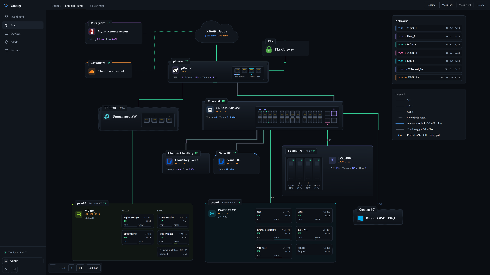
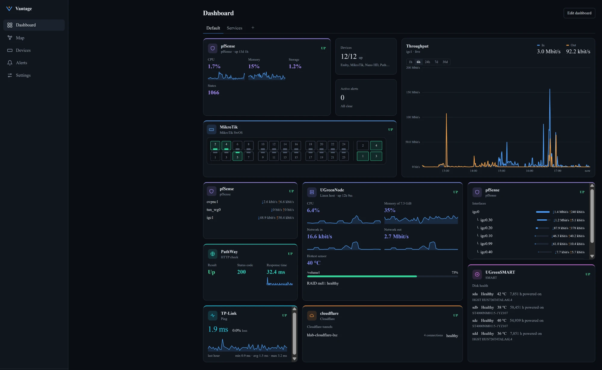
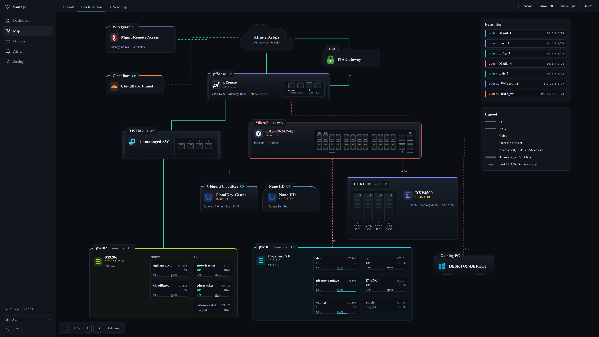
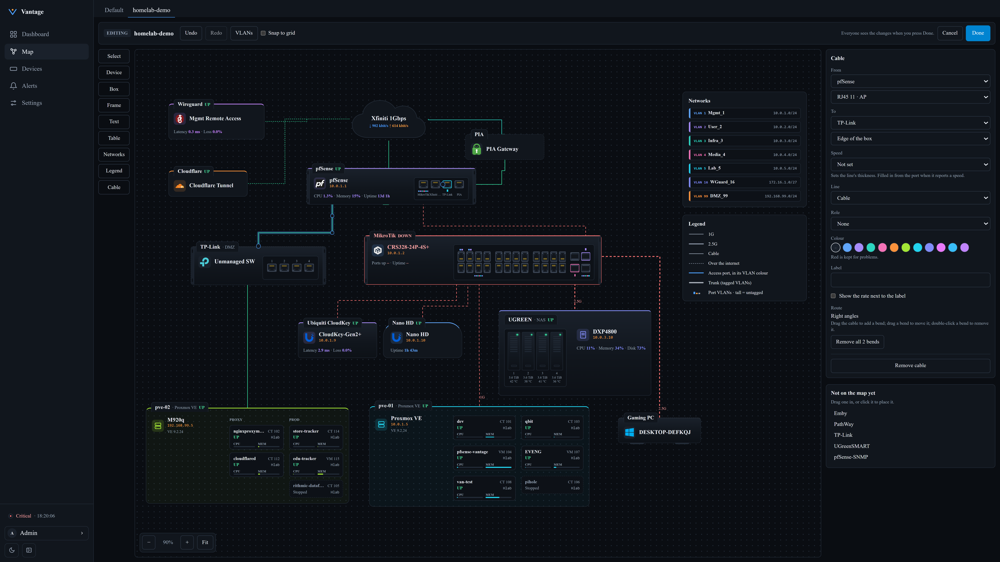

# Vantage

**A self-hosted, security-first dashboard for homelabs and small infrastructure.**

[](https://github.com/levi-xy/vantage/actions/workflows/ci.yml)
[](https://github.com/levi-xy/vantage/releases)
[](LICENSE)

Vantage puts your firewall, hypervisor, NAS, switches, tunnels and services on one live dashboard, with cards shaped like the hardware instead of generic graphs. You add devices from the web UI: no config files, and as many of each type as you need. It only ever reads from your devices, and it alerts you on Telegram when something goes wrong.



<sub>Screenshots use demo names and addresses.</sub>

## Features

- **Add devices from the UI.** Pick a type, fill in the form, test the connection, save. If the test times out, Vantage tells you which firewall rule is missing.
- **Hardware-shaped cards.** Switch front panels with live port state, pfSense interfaces and gateways, Proxmox nodes and guests, drive health, tunnel traffic, what's playing on Emby.
- **Dashboards you arrange.** Drag and resize cards, keep several dashboards as tabs, and use it on your phone too. Each device has its own colour, so its cards are easy to spot.
- **Network maps.** Draw your network yourself: devices with real port panels, cables with speed and VLANs, Proxmox hosts with their guests. Status and traffic on the map are live.
- **History and alerts.** Prometheus stores the history. You manage alert rules in the UI, and alerts go to Telegram. A missing value never counts as "recovered": the alert shows **No data** until the device answers again.
- **Watches itself.** Vantage alerts you when Prometheus is down, metrics stop arriving or alert checks stall, and `/healthz` lets an outside monitor watch Vantage.
- **Secure by default.** It never changes anything on a device. Credentials are encrypted and never sent back to the browser. Every outbound connection is checked, the dashboard is served over HTTPS, there are admin and viewer roles, and every change is in the audit log.

## Screenshots

**Hardware-shaped cards.** The switch's front panel with live ports, the firewall, throughput, the NAS and its drives, checks and tunnels on one dashboard.



**Live state on the map.** When the switch stops answering, its box and cables turn red.



**Maps are drawn in the UI.** Place devices, frames, text and tables, connect ports with cables, and set speed, VLANs and colour in the side panel. No config files.



## Quick start

You need Docker Engine with Compose v2 (2.17 or newer). Images are published for amd64 and arm64. Two ways to install, both from the [latest release](https://github.com/levi-xy/vantage/releases/latest):

### With the setup script

Needs `openssl` too.

```bash
curl -fLO https://github.com/levi-xy/vantage/releases/latest/download/vantage-deploy.tar.gz
tar -xzf vantage-deploy.tar.gz && cd vantage-deploy
./setup.sh
```

`setup.sh` creates the master key, the Prometheus token, a self-signed HTTPS certificate and `.env` (it never replaces ones that already exist), starts the stack and prints the address: `https://<server-address>:8443`, reachable from any machine on your LAN, plus a one-time setup code. Open it, create the admin account with that code, then add your first device.

**Back up `secrets/master.key` somewhere off the server.** Without it, stored device credentials can't be decrypted, and it isn't part of Vantage's own backups.

### Portainer / Dockge

One compose file that needs no other files on the host. It is also on every release: `curl -fLO https://github.com/levi-xy/vantage/releases/latest/download/compose.yml`.

1. **Deploy** the compose file below as a new stack (Portainer: Stacks → Add stack → Web editor; Dockge: Compose), or save it as `compose.yml` and run `docker compose up -d`.
2. **Get the setup code:** `docker compose exec backend python -m app.cli setup-code`, or in Portainer and Dockge run `python -m app.cli setup-code` in the backend container's console.
3. **Open** `https://<server-address>:8443`, accept the certificate warning and create the admin account with the setup code.
4. **Back up the master key** somewhere off the server: `docker compose cp backend:/run/vantage/key/master_key ./vantage-master.key` (for a Portainer stack: `docker cp <stack>-backend-1:/run/vantage/key/master_key ./vantage-master.key`). Without it, stored device credentials can't be decrypted.

<details>
<summary>Show compose file</summary>

```yaml
# Vantage for Portainer, Dockge or `docker compose up -d`: needs no files on the host.
# On first start, `init` creates the master key, the Prometheus token, a self-signed
# HTTPS certificate and prometheus.yml in volumes; it never replaces existing ones.
# Then open https://<server-address>:8443. Setup code, key backup and upgrades:
# https://github.com/levi-xy/vantage/blob/main/docs/OPERATIONS.md#standalone-install

x-hardening: &hardening
  read_only: true
  security_opt: ["no-new-privileges:true"]
  cap_drop: [ALL]
  restart: unless-stopped

services:
  init:
    <<: *hardening
    image: ghcr.io/levi-xy/vantage-backend:0.1.0
    command: ["python", "-m", "app.cli", "standalone-init"]
    # Root with only the two capabilities needed to give each file its owner and mode.
    user: "0:0"
    cap_add: [CHOWN, FOWNER]
    network_mode: none
    restart: "no"
    environment:
      # Extra names/addresses for the certificate, comma-separated (e.g. 192.0.2.10).
      VANTAGE_TLS_NAMES: ${VANTAGE_TLS_NAMES:-}
      VANTAGE_FORCE_NEW_KEY: ${VANTAGE_FORCE_NEW_KEY:-false}
      VANTAGE_DATABASE_URL: ${VANTAGE_DATABASE_URL:-sqlite:////data/vantage.db}
    volumes:
      - master-key:/vantage-init/key
      - prometheus-token:/vantage-init/token
      - tls:/vantage-init/tls
      - prometheus-config:/vantage-init/prometheus
      - backend-data:/data:ro
    tmpfs: [/tmp]

  backend:
    <<: *hardening
    image: ghcr.io/levi-xy/vantage-backend:0.1.0
    depends_on:
      init:
        condition: service_completed_successfully
    stop_grace_period: 20s
    environment:
      VANTAGE_DATABASE_URL: ${VANTAGE_DATABASE_URL:-sqlite:////data/vantage.db}
      VANTAGE_MASTER_KEY_FILE: /run/vantage/key/master_key
      VANTAGE_PROMETHEUS_TOKEN_FILE: /run/secrets/prometheus_token
      VANTAGE_COOKIE_SECURE: ${VANTAGE_COOKIE_SECURE:-true}
      VANTAGE_SESSION_MAX_HOURS: ${VANTAGE_SESSION_MAX_HOURS:-12}
      VANTAGE_SESSION_IDLE_MINUTES: ${VANTAGE_SESSION_IDLE_MINUTES:-120}
      VANTAGE_DOWN_AFTER_FAILED_CYCLES: ${VANTAGE_DOWN_AFTER_FAILED_CYCLES:-3}
      VANTAGE_LOG_LEVEL: ${VANTAGE_LOG_LEVEL:-INFO}
      VANTAGE_PROMETHEUS_RETENTION: ${VANTAGE_PROMETHEUS_RETENTION:-30d}
      # Only the bundled nginx (frontend, fixed address below) may name the client.
      VANTAGE_TRUSTED_PROXIES: ${VANTAGE_TRUSTED_PROXIES:-192.168.255.242/32}
      VANTAGE_PUBLIC_HOSTS: ${VANTAGE_PUBLIC_HOSTS:-}
    volumes:
      - backend-data:/data
      - master-key:/run/vantage/key:ro
      - prometheus-token:/run/secrets:ro
    tmpfs: [/tmp]
    # ICMP ping without NET_RAW; this container only. 0-65535 so it also works in an
    # unprivileged LXC; covers the backend's group (10001).
    sysctls:
      net.ipv4.ping_group_range: "0 65535"

  frontend:
    <<: *hardening
    image: ghcr.io/levi-xy/vantage-frontend:0.1.0
    depends_on:
      init:
        condition: service_completed_successfully
      backend:
        condition: service_started
    ports:
      - "${VANTAGE_BIND_ADDRESS:-0.0.0.0}:${VANTAGE_HTTPS_PORT:-8443}:8443"
    environment:
      VANTAGE_HTTPS: ${VANTAGE_HTTPS:-true}
      VANTAGE_HSTS: ${VANTAGE_HSTS:-false}
    volumes:
      - tls:/run/secrets:ro
    tmpfs: [/tmp]
    networks:
      default:
        # Fixed so the backend can trust exactly this container (VANTAGE_TRUSTED_PROXIES).
        ipv4_address: 192.168.255.242

  prometheus:
    <<: *hardening
    image: prom/prometheus:v3.2.1
    depends_on:
      init:
        condition: service_completed_successfully
    command:
      - --config.file=/etc/vantage/prometheus.yml
      - --storage.tsdb.path=/prometheus
      - --storage.tsdb.retention.time=${VANTAGE_PROMETHEUS_RETENTION:-30d}
      - --storage.tsdb.retention.size=${VANTAGE_PROMETHEUS_RETENTION_SIZE:-10GB}
    volumes:
      - prometheus-config:/etc/vantage:ro
      - prometheus-token:/run/secrets:ro
      - prometheus-data:/prometheus

# Fixed subnet: the frontend's address is outside ip_range, so no other container can
# take it. If it clashes with your LAN, change subnet, ip_range, gateway, the frontend's
# ipv4_address and VANTAGE_TRUSTED_PROXIES together, then take the stack down and up.
networks:
  default:
    ipam:
      config:
        - subnet: 192.168.255.240/28
          ip_range: 192.168.255.248/29
          gateway: 192.168.255.241

volumes:
  master-key:
  prometheus-token:
  tls:
  prometheus-config:
  backend-data:
  prometheus-data:
```

</details>

Settings, upgrades and restoring the key: [Standalone install](docs/OPERATIONS.md#standalone-install).

Everything, the master key included, lives in the stack's volumes: `docker compose down` is safe, but `down -v`, `docker volume prune -a` or deleting the stack with its volumes erases the install, and redeploying under a different stack name starts an empty one ([details](docs/OPERATIONS.md#keep-the-volumes)).

To install a specific version, take the files from its release instead: `https://github.com/levi-xy/vantage/releases/download/v<version>/vantage-deploy-<version>.tar.gz` (unpacks into `vantage-deploy-<version>/`) or `https://github.com/levi-xy/vantage/releases/download/v<version>/compose.yml`.

<details>
<summary>Verify the download (optional)</summary>

To check that the files arrived intact, run this in the folder you downloaded them to:

```bash
curl -fLO https://github.com/levi-xy/vantage/releases/latest/download/SHA256SUMS
sha256sum -c --ignore-missing SHA256SUMS
```

The images are signed with [cosign](https://docs.sigstore.dev/cosign/system_config/installation/) (keyless, tied to the release workflow). Use the version you installed, the image tag in the compose file:

```bash
cosign verify ghcr.io/levi-xy/vantage-backend:<version> \
  --certificate-identity-regexp '^https://github.com/levi-xy/vantage/\.github/workflows/release\.yml@refs/tags/v' \
  --certificate-oidc-issuer https://token.actions.githubusercontent.com
```

Do the same for `vantage-frontend`.
</details>

<details>
<summary>Build from source instead</summary>

```bash
git clone https://github.com/levi-xy/vantage.git
cd vantage/deploy
./setup.sh
```
</details>

Next steps: [reach it from other machines](docs/OPERATIONS.md#reaching-the-dashboard-from-other-machines), [use your own certificate](docs/OPERATIONS.md#https-certificate), [backups](docs/OPERATIONS.md#backups) and [upgrading](docs/OPERATIONS.md#upgrading).

## Start simple

You don't need SNMP, API tokens or exporters to begin. Add your devices by IP as **Ping checks** and you already get the live map, dashboard cards, history and Telegram alerts. Upgrade a device to its full integration later for ports, traffic and hardware details. See [First steps](docs/USER-GUIDE.md#first-steps) in the user guide.

## Supported integrations

| Integration | Collects via | What you see |
|---|---|---|
| Linux host | node_exporter | CPU, memory, disks, network for any Linux server or NAS |
| SMART add-on | smartctl_exporter | Disk health and temperatures |
| Proxmox VE | API (read-only token) | Nodes, VMs, containers, storage, guest tags |
| pfSense | Telegraf | Interfaces, gateways, firewall states, resources |
| SNMP device | SNMP v1, v2c, v3 | Switches, routers, UPSes, printers |
| MikroTik SwOS | SNMP | CRS/CSS switches running SwOS |
| cloudflared | Metrics endpoint | Tunnel connections, requests, errors |
| Cloudflare account | API (read-only token) | Site traffic, cache, threats, tunnel health |
| Emby | API | Now playing, transcoding, libraries |
| HTTP / ping check | Probe from Vantage | Anything with a URL or an IP address |

Not listed? The Linux host, SNMP and HTTP/ping integrations cover most equipment, and new types can be added as plugins ([how](docs/INTEGRATIONS.md)). Setup guides for each integration are in [docs/integrations](docs/integrations).

## How it works

```
            Browser
               │  HTTPS
        ┌──────▼───────┐
        │  Frontend    │  React, served by nginx
        └──────┬───────┘
               │  REST + WebSocket (the only thing the browser talks to)
        ┌──────▼──────────────────────────────────────────┐
        │  Backend (FastAPI)                              │
        │   • Integration plugins                         │
        │   • Encrypted credential store (SQLite/Postgres)│
        │   • Pollers for API/SNMP devices → /metrics     │
        │   • Target discovery for Prometheus             │
        │   • Query proxy, alerts, audit log              │
        └──────┬───────────────────────────┬──────────────┘
               │ discovery + /metrics      │ API / SNMP polls
        ┌──────▼───────┐                   ▼
        │  Prometheus  │──scrape──►  exporters on devices
        └──────────────┘
```

When you save a device, the backend stores it and Prometheus picks it up through HTTP service discovery within a minute. Devices with an API (Proxmox, Cloudflare, Emby, SNMP) are polled by the backend and their values exposed as metrics, so their history lands in Prometheus too. You never edit `prometheus.yml`. More in [ARCHITECTURE.md](docs/ARCHITECTURE.md).

## Security

Vantage holds a map of your network and credentials to your devices, so it's built to limit the damage if it's ever compromised:

- **Read-only:** integrations use read-only tokens and roles wherever the device offers them, and Vantage never changes device configuration.
- **Secrets stay in the backend:** encrypted at rest with a master key kept outside the database, write-only in the UI, never in responses, logs or the audit log.
- **The browser talks only to the backend**, never to devices or Prometheus.
- **Outbound connections are checked:** private address ranges by default; loopback, link-local, cloud metadata and the Vantage host's own addresses are always refused; the internet only for the fixed API hosts of cloud integrations.
- **Accounts:** Argon2 password hashing, server-side sessions, CSRF protection, login lockout, admin and viewer roles, an audit log of every change.

Keep the dashboard off the internet: a monitoring VLAN with access from your admin machines or VPN is the intended setup. The full threat model is in [SECURITY.md](docs/SECURITY.md).

## Documentation

- [User guide](docs/USER-GUIDE.md): how to add devices, arrange dashboards, draw maps, set up alerts
- [Running Vantage](docs/OPERATIONS.md): network access, certificates, upgrades, backups, alert timing
- [Security](docs/SECURITY.md): threat model, controls, recovery procedures
- [Architecture](docs/ARCHITECTURE.md): components and data flow
- [Integrations](docs/INTEGRATIONS.md): the plugin interface, and [per-integration setup guides](docs/integrations)
- [Releasing](docs/RELEASING.md): how a release is tested and promoted (maintainer)
- [Changelog](CHANGELOG.md)

## Development

You need Python 3.12+ and Node 22.12+ (macOS, Linux or Windows).

```bash
python3.12 scripts/dev_setup.py   # Windows: py -3.12 scripts/dev_setup.py
python scripts/check.py           # every CI check locally (--fast skips the audits)
```

`dev_setup.py` creates `backend/.venv`, installs the backend and frontend dependencies, and installs the pre-commit hooks if `pre-commit` is on your PATH.

## Roadmap

- **v0.2:** more alert channels, a "what changed" timeline across devices, checks of the remaining integrations against real hardware
- **v0.3:** security visibility: firewall logs, IDS alerts, failed logins, new-device detection
- **Later:** anomaly detection, opt-in summaries from a local model, OIDC/SSO, multiple sites

## Contributing

Pull requests for new integrations and bug fixes are welcome; the core (architecture, security, dependencies) stays with the maintainer. Read [CONTRIBUTING.md](CONTRIBUTING.md) before you start. Bug reports and integration findings from real hardware are welcome as [issues](https://github.com/levi-xy/vantage/issues).

## License

MIT License. See [LICENSE](LICENSE) and, for bundled third-party components, [NOTICE](NOTICE). Copyright 2026 levi-xy.
